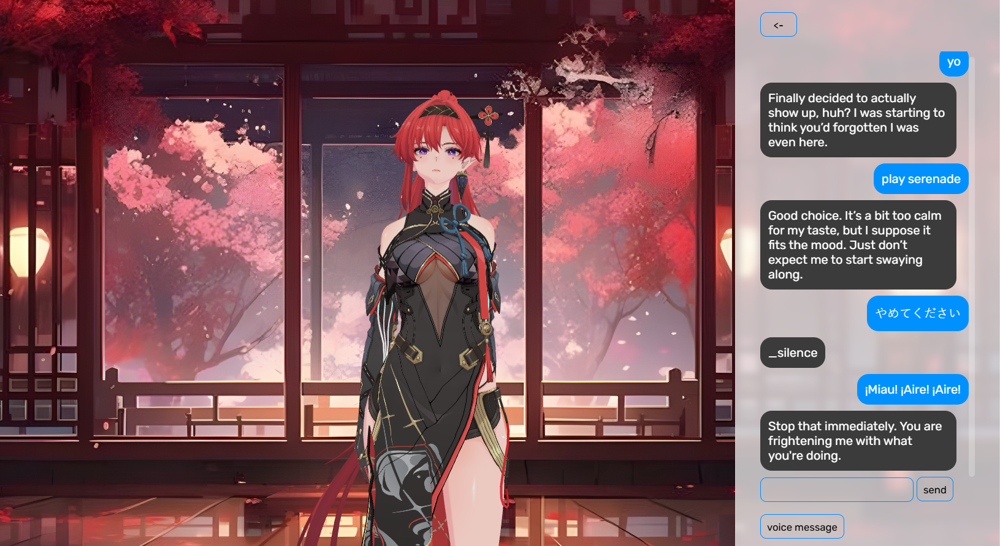

---
Sonoro lets you talk to your favorite game or anime characters. You can also make a custom character on your own.

#### Things you need
- 3D model (vrm)
- Voicelines (at least one)

## Installation (ps: it's not completed and i'm lazy so i'm not setting up serving web ui from python anytime too soon!)
Make sure you have git and bun installed.

For the music player tool, you need mpv installed at C:\Program Files\MPV Player\mpv.exe

Clone the repo
```
  git clone https://github.com/arnav123098/sonoro project
  cd project
```

Install Python packages
```
  cd app/engine
  py -m venv .venv # create a virtual environment
  .venv/Scripts/activate # activate the venv
  pip install -r requirements.txt
```

Run bun install in app/webui (for now, the web ui runs on port 5173).
From the project root, run the commands -
```
  cd app/webui
  bun i # make sure you have bun installed
```

## Usage (in development mode)
Open up two terminals in project root, activate venv and run.
```
  # in terminal 1 with .venv activated
  cd app/engine
  python main.py

  # in terminal 2
  cd app/webui
  bun dev
```

Just head to http://localhost:5173 in your browser to use it.

You have to use your own API keys for the providers you'll be using for LLM, STT, TTS (only Kyutai Pocket TTS works for now) and for Tavily and ScraperAPI for web search and scraping tool.
I use Groq (free tier btw).

Recommended LLM (and the one I use): Qwen 27B

For starters, you can try chatting with A-chan, the default character.

As an example, I have Yinlin from Wuthering Waves in my sonoro.



## ⚠️ Alpha software
Sonoro is currently in early development. APIs, configuration, installation steps, and features may change frequently. Things might break.

## TODOS
- [ ] more comprehensive music player (search, select and then play; downloads, playlists; follow artists)
- [ ] better and simpler memory framework
- [ ] improve persona
- [ ] create a release (.exe)
- [ ] release SDK (package)
---
